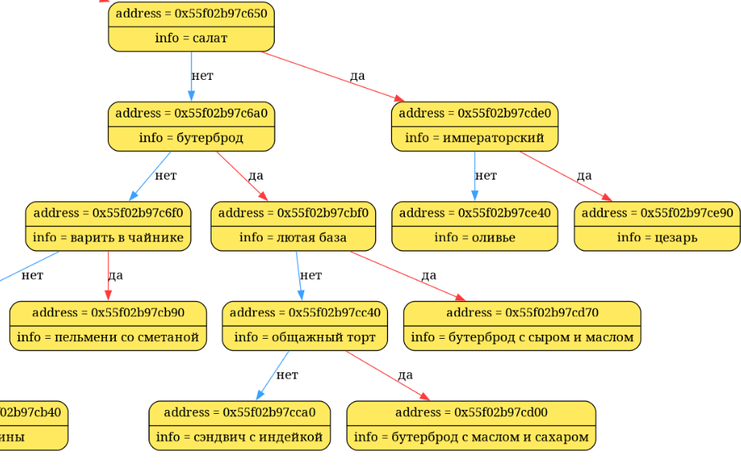
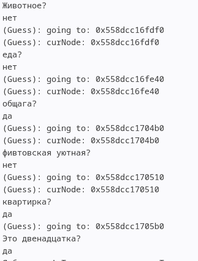
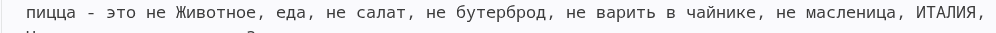
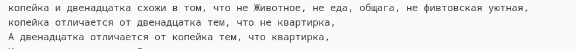

<a name="top"></a>

# Akinator

[](#-quickstart)

## Table of contents
- [About](#-about)
- [Quickstart](#-quickstart)
- [Dependencies](#-dependencies)
- [Building](#-building)
- [What's New](#-whats-new)
- [Documentation](#-documentation)
- [Contacts](#%EF%B8%8F-contacts)

## About

**Akinator** V2.0 is a chatbot with some interesting features:  

* Guessing any object, you can imagine! If it's not found it will be automatically added!
* Colorful & intuitive dump file (choice between text and visual dump is available)
* Giving a definition to any (known) object!
* Comparing two objects!
* Saving (or not) base, you improved by guessing unknown words!

## Feature list 

1. Binary tree initialization, destruction, insertion supported!
2. Dump to the .txt file supported!
3. Dump to the .png file supported!
4. Guess function
5. Give definition function
6. Compare function

The visual dump sample:



Guess function sample:



Definition function sample:



Compare function sample:



## Quickstart

Download latest version from releases :) That's it!

## Dependencies

The list of dependencies:
1) g++ compiler 16.2.1 and newer
2) [graphviz library](https://www.graphviz.org/download/)

## Building

If you want to build this project on your machine follow this steps:

0) Check dependencies
1) ``` mkdir Akinator ```
2) ``` cd    Akinator ```
3) ``` git clone https://github.com/ArtScienceMK/AdvancedProgramming/tree/main/Akinator ```
4) ``` g++ MyStack.cpp Tree.cpp -o tree ``` to disable any debug output

   ``` g++ MyStack.cpp Tree.cpp -DDEBUG -DSTACK_DEBUG -o tree  ``` to enable all debug output into console and activate asserts
5) ``` ./tree ```

Congratulations!  


## What's New

Added comparison!

## Documentation

Go to [index page](https://artsciencemk.github.io/AdvancedProgramming/), find needed function with search bar in the right upper corner.

## Contacts

If you will have any questions, suggestions and so on, just text me)

Mail: 55555artem.kulakov@gmail.com
