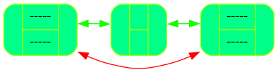
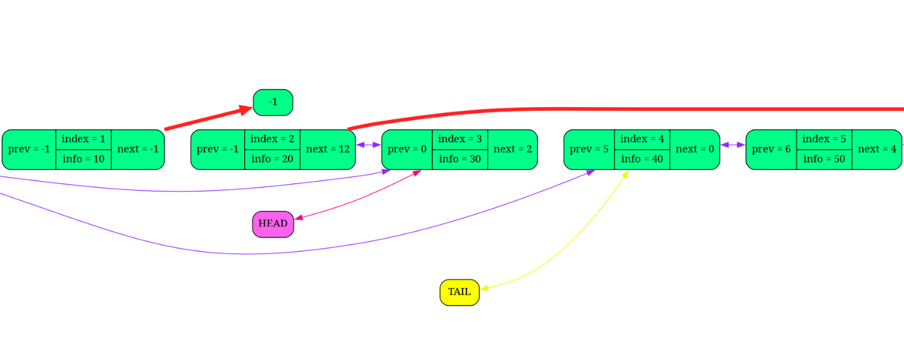
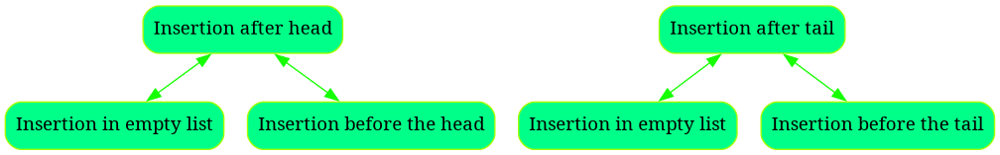
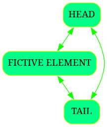

<a name="top"></a>

# Doubly linked list

[](#-quickstart)

## Table of contents
- [About](#-about)
- [Quickstart](#-quickstart)
- [Dependencies](#-dependencies)
- [Building](#-building)
- [What's New](#-whats-new)
- [Documentation](#-documentation)
- [Contacts](#%EF%B8%8F-contacts)

## About

**Doubly linked list** V2.0 is an implementation of popular data structure with some useful features:  

* Dump your data structure in text / png or html file at any moment!
* Colorful & intuitive dump files design
* Debug with comfort!

## Feature list 

1. Doubly linked list initialization, destruction, insertion, deletion supported!
2. Dump to the .txt file supported!
3. Dump to the .png file supported!
4. Dump to the .html file provided (incorporating both .txt and .png files inside!)!
5. Insertion & deletion with constant time complexity!

The visual dump sample:



## Quickstart

Download latest version from releases :) That's it!

## Dependencies

The list of dependencies:
1) g++ compiler 16.2.1 and newer
2) [graphviz library](https://www.graphviz.org/download/)

## Building

If you want to build this project on your machine follow this steps:

0) Check dependencies
1) ``` mkdir List ```
2) ``` cd    List ```
3) ``` git clone https://github.com/ArtScienceMK/AdvancedProgramming/tree/main/List ```
If you want to compile assembler
4) ``` g++ List.cpp -o list ``` to disable any debug output

   ```  g++ List.cpp -DDEBUG -o list ``` to enable all debug output into console and activate asserts
5) ``` ./list ```

Congratulations!  


## What's New

Added html dump!

## Documentation

[Index page](docs/html/index.html)

### Why list, cycled on fictive element is better, than usual list?

Let's consider insertion function in usual case:

You should handle at least 4 edge cases:



While handling all of them, it's easy to make a mistake.

BUT THERE IS A SOLUTION!

Consider cycling list on fictive element, it will look like.



Note, there is no need in handling 4 edge cases now!

## Contacts

If you will have any questions, suggestions and so on, just text me)

Mail: 55555artem.kulakov@gmail.com


Nah, just check